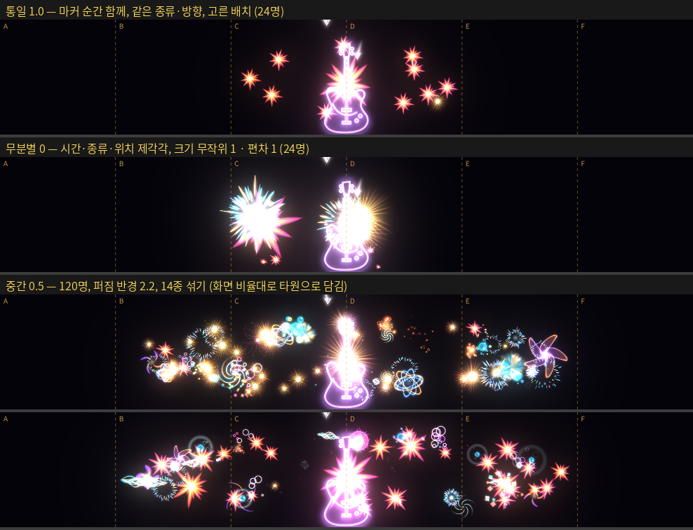

# RESONANCE LAB

공연 미디어아트용 **WebGL 비주얼 시뮬레이터**입니다. 음악 마커에 맞춰 움직이는 라인·면·파장·유체·입자·로봇팔·레이저·리듬게임 레이어를 쌓아
초광폭 화면(예: 3840×640, 5860×768, 360° 연결)용 영상 리소스를 만들고, PNG 시퀀스(알파)·MP4·ProRes 4444로 출력합니다.
2027 베오그라드 엑스포 한국관 공연 영상 제작을 위해 만들었습니다.

- 인터넷 없이 동작합니다(외부 서버·CDN·웹폰트 없음).
- **결정론적 프레임 시계**: 같은 프로젝트·Seed면 어느 프레임을 다시 렌더해도 같은 결과가 나옵니다.
- 라이센스: **Unlicense (퍼블릭 도메인)** — 누구나 조건 없이 사용·수정·배포할 수 있습니다. [LICENSE](LICENSE)


## 실행

| 방법 | 설명 |
|---|---|
| **브라우저** | `app/RESONANCE_LAB.html`을 크롬·엣지로 엽니다. 파일 하나로 동작합니다. |
| **단일 실행 파일 (Windows)** | [Releases](../../releases)에서 `RESONANCE_LAB_v0.5.8_portable.exe`를 받아 실행합니다. 설치 불필요. ProRes 출력용 FFmpeg 포함. |

자세한 기능은 [docs/사용법.md](docs/사용법.md)를 보세요.

처음 실행할 때 Windows SmartScreen 경고가 뜨면 **추가 정보 → 실행**을 누르세요(코드 서명이 없는 프로그램). 그 밖의 문제는 [docs/실행안내_다른PC에서.txt](docs/실행안내_다른PC에서.txt)를 보세요.

## 저장소 구성

```
src/                    전체 소스 (ES 모듈, 평문)
  main.js               진입점 — 모듈 불러오는 순서 (레이어 버튼 순서와 같음)
  core/registry.js      레지스트리: 레이어 모듈(modules) · 프리셋(presets)
  core/rl.js            디버그용 전역 RL (콘솔에서 RL.Engine 등 확인)
  gl.js batch.js engine.js fx.js builtins.js   WebGL2 엔진 · 렌더 배치 · 후처리 · 기본 아이콘
  mod_*.js              레이어 모듈 — 파장·유체·파티클·도트·라인·빔·면·도형·오브젝트 유영·로봇팔·네온 기하·레이저
  rhythm/               리듬게임 레이어 (fx_glsl.js: 셰이더 이펙트 14종, mod_rhythm.js: 노트·심벌·다중참여)
  robot_mesh.js         로봇팔 메시 데이터
  presets.js            프리셋 (씬 번호)
  audio.js export.js    오디오 분석 · PNG/MP4/ProRes 출력
  ui.js ui2.js index.html style.css   화면
  types/                타입 정의 (npm run typecheck)
build.mjs               src/ → app/RESONANCE_LAB.html (Vite, 파일 하나로 실행, 축약 없음)
vite.config.mjs         개발 서버 설정 (npm run dev)
app/RESONANCE_LAB.html  빌드 결과 (받아서 바로 실행)
desktop/                Electron 데스크톱 셸 — main.cjs(연결), preload.cjs(화면에 주는 기능), lib/(기록·설정·파일 규칙·FFmpeg 출력)
tools/build_portable.sh Windows 포터블 exe · 폴더형 앱 빌드
tests/                  회귀 (regress.mjs, golden.json) · 스키마 (schema.mjs) · 데스크톱 (desktop.mjs, desktop_e2e.mjs)
docs/                   사용법 · 실행 안내 · 이미지
```

## 수정·빌드

```bash
npm install          # 처음 한 번
npm run dev          # 개발 서버 — 소스를 고치면 브라우저에 바로 반영
npm run build        # src/ → app/RESONANCE_LAB.html (배포용 단일 파일)
npm run lint         # 문법·선언 검사
npm run typecheck    # 타입 검사 (JSDoc + TypeScript, src/types/)
npm run test:schema  # 레이어 설정 항목·프리셋 값 검사 (수 초)
npm run test:desktop # 데스크톱 셸 규칙 검사 (Electron 없이, 수 초)

# Windows 포터블 exe (선택) — desktop/ffmpeg/ffmpeg.exe 를 직접 넣은 뒤 (https://ffmpeg.org/download.html, 저장소에는 없음)
bash tools/build_portable.sh   # → dist/public/RESONANCE_LAB_v<버전>_portable.exe
```

### 회귀 검사

```bash
npm test               # 빌드 → 린트 → 타입 → 스키마 → 데스크톱 → 회귀(프리셋 14개 + 리듬 다중참여 케이스 × 3시점 = 45장)
npm run test:update    # 기준 프레임 다시 저장 — 의도한 화면 변경일 때만
```

- 같은 조건을 두 번 렌더해 프레임이 같은지(결정론), 기준 프레임(`tests/golden.json`)과 같은지 확인합니다.
- 렌더는 SwiftShader(CPU)로 해서 PC·그래픽카드와 상관없이 같은 결과가 나옵니다. 크롬·엣지가 설치돼 있어야 하며, 경로는 `CHROME_PATH`로 지정할 수 있습니다.
- 크롬 버전 차이로 생기는 아주 작은 차이를 허용하려면 `RLAB_LOOSE=1 npm test`.
- 데스크톱 앱을 실제로 띄워 보는 검사(선택): `ELECTRON_PATH=<electron> FFMPEG_PATH=<ffmpeg> node tests/desktop_e2e.mjs` (Linux 서버는 `xvfb-run` 으로).

앞으로의 구조 개선 계획은 [docs/개발_로드맵.md](docs/개발_로드맵.md)에 있습니다.

### 규칙
- **결정론**: 같은 프로젝트·Seed면 어느 프레임을 다시 렌더해도 같아야 합니다. 렌더 계산에는 `Math.random()` 대신 `RL.rng` / `RL.hashSeed`를 쓰고,
  프레임마다 쌓이는 상태 대신 시간·마커 시점으로부터 계산합니다. 이 규칙이 깨지면 출력한 PNG 시퀀스가 프레임마다 흔들립니다.
- **클린룸**: 다른 프로그램의 코드를 복제하거나 파생하지 않습니다.
- **모듈 구조**: 각 파일은 기능을 이름 있는 export로 내보내고, 쓰는 쪽은 `import * as webgl from './gl.js'`처럼 파일 단위로 가져옵니다
  (별칭: gl→`webgl`, batch→`batches`, builtins→`icons`, fx→`fxlib`, engine→`eng`, robot_mesh→`robotMesh`, audio→`audioLib`, export→`exportLib`, ui→`uiApp`, ui2→`assetIO`).
  전역 `RL`은 디버그 콘솔용 호환 등록으로만 남아 있으니 새 코드에서 쓰지 마세요.
- 레이어 모듈은 `registry.modules.<이름> = { label, icon, blend, schema, create(engine, L) }` 형태로 등록하고, `src/main.js`에 import를 추가합니다. `schema`가 인스펙터 옵션이 됩니다.
- 셰이더 이펙트를 추가하려면 `src/rhythm/mod_rhythm.js`의 `FX_STYLES`에 항목을 넣고, `fx_glsl.js`의 `effect()` 분기에 같은 순서로 함수를 추가합니다.
  모든 이펙트는 **단위 원(반지름 1) 안에서만** 그려야 화면 밖으로 나가지 않습니다.

## 리듬게임 다중참여 이펙트

체험 참여자들이 함께 칠 때 심벌 주변에서 추가로 터지는 이펙트입니다. 참여 인원·빈도는 키프레임으로 연출합니다.



| 옵션 | 내용 |
|---|---|
| 참여 인원 / 1인당 참여 빈도 / 자유 참여 | 마커마다 몇 명이 함께 칠지, 박자 사이에 제멋대로 치는 빈도 |
| 터지는 방식 (0 무분별 ↔ 1 통일) | 1: 마커 순간 함께, 같은 종류·방향, 고른 배치 / 0: 시간·종류·위치·방향 제각각 |
| 크기 무작위 적용 / 크기 편차 | 크기를 무작위로 할지, 크기 차이를 얼마나 크게 할지 |
| 퍼짐 반경 / 중심 비움 / 시드 | 심벌 중심에서 퍼지는 범위, 심벌 위 빈 영역, 배열 바꾸기 |

## 변경 기록

[CHANGELOG.md](CHANGELOG.md)

## 제3자 구성 요소

[THIRD_PARTY_NOTICES.md](THIRD_PARTY_NOTICES.md) — mp4-muxer(MIT), Electron(MIT), FFmpeg(LGPL), 로봇팔 모델(제조사 권리).
