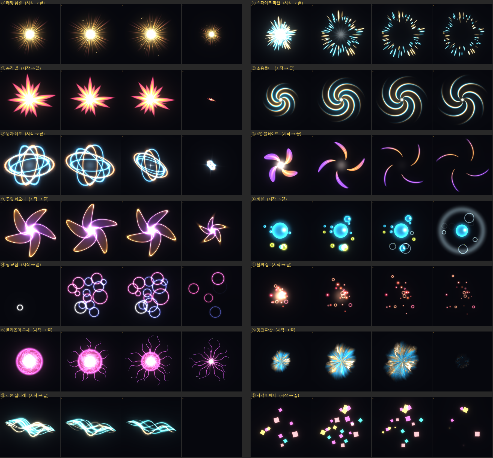

# RESONANCE LAB

공연 미디어아트용 **WebGL 비주얼 시뮬레이터**입니다. 음악 마커에 맞춰 움직이는 라인·면·파장·유체·입자·로봇팔·레이저·리듬게임 레이어를 쌓아
초광폭 화면(예: 3840×640, 5860×768, 360° 연결)용 영상 리소스를 만들고, PNG 시퀀스(알파)·MP4·ProRes 4444로 출력합니다.
2027 베오그라드 엑스포 한국관 공연 영상 제작을 위해 만들었습니다.

- 인터넷 없이 동작합니다(외부 서버·CDN·웹폰트 없음).
- **결정론적 프레임 시계**: 같은 프로젝트·Seed면 어느 프레임을 다시 렌더해도 같은 결과가 나옵니다.
- 라이센스: **Unlicense (퍼블릭 도메인)** — 누구나 조건 없이 사용·수정·배포할 수 있습니다. [LICENSE](LICENSE)



## 실행

| 방법 | 설명 |
|---|---|
| **브라우저** | `app/RESONANCE_LAB.html`을 크롬·엣지로 엽니다. 파일 하나로 동작합니다. |
| **단일 실행 파일 (Windows)** | [Releases](../../releases)에서 `RESONANCE_LAB_v0.5.6_portable.exe`를 받아 실행합니다. 설치 불필요. ProRes 출력용 FFmpeg 포함. |

처음 실행할 때 Windows SmartScreen 경고가 뜨면 **추가 정보 → 실행**을 누르세요(코드 서명이 없는 프로그램). 그 밖의 문제는 [docs/실행안내_다른PC에서.txt](docs/실행안내_다른PC에서.txt)를 보세요.

## 저장소 구성

```
app/RESONANCE_LAB.html     프로그램 본체 (빌드 결과, 이 파일 하나로 실행)
src/rhythm/fx_glsl.js      리듬게임 셰이더 이펙트 14종 (GLSL)
src/rhythm/mod_rhythm.js   리듬게임 레이어 (노트·심벌·이펙트·다중참여)
src/public/overrides.js    공개판 설정 (프리셋 이름 = 씬 번호, 라이센스 표기)
desktop/                   Electron 데스크톱 셸 (main.cjs, preload.cjs, package.json, eb.json)
tools/build.py             src/ 의 소스를 app/RESONANCE_LAB.html 에 반영
tools/build_portable.sh    Windows 포터블 exe 빌드
docs/                      실행 안내, 이미지
```

엔진·UI·다른 레이어의 원본 소스는 현재 저장소에 포함되어 있지 않으며, `app/RESONANCE_LAB.html` 안에 빌드된 형태로만 들어 있습니다.
지금 소스로 수정할 수 있는 부분은 리듬게임 레이어와 공개판 설정입니다.

## 수정·빌드

```bash
# 1) src/rhythm/*.js 또는 src/public/overrides.js 수정
# 2) 본체에 반영
python3 tools/build.py
# 3) app/RESONANCE_LAB.html 을 브라우저로 열어 확인 (새로고침만 하면 됨)

# 반영 여부 검사 (소스와 본체가 다르면 실패)
python3 tools/build.py --check
```

Windows 포터블 exe(선택):

```bash
# desktop/ffmpeg/ffmpeg.exe 를 직접 넣은 뒤 (https://ffmpeg.org/download.html, 저장소에는 없음)
bash tools/build_portable.sh        # → dist/RESONANCE_LAB_v<버전>_portable.exe
```

### 리듬게임 모듈 규칙
- 전역 `RL` 네임스페이스로만 다른 코드와 연결됩니다. 사용하는 코어 API:
  `RL.modules, RL.rng, RL.hashSeed, RL.hexToRgb, RL.parseFaces, RL.evalKeys, RL.clear, RL.drawBurst, RL.drawImageBurst, RL.atlasUV, RL.FX_TYPES, RL.program, RL.draw`
- **결정론 유지**: `Math.random()` 대신 `RL.rng` / `RL.hashSeed`를 쓰고, 프레임마다 쌓이는 상태 대신 시간·마커 시점으로부터 계산합니다.
  이 규칙이 깨지면 출력한 PNG 시퀀스가 프레임마다 흔들립니다.
- 셰이더 이펙트를 추가하려면 `FX_STYLES`에 항목을 넣고, `FX_GLSL`의 `effect()` 분기에 같은 순서로 함수를 추가합니다.
  모든 이펙트는 **단위 원(반지름 1) 안에서만** 그려야 화면 밖으로 나가지 않습니다.

## 리듬게임 다중참여 이펙트

체험 참여자들이 함께 칠 때 심벌 주변에서 추가로 터지는 이펙트입니다. 참여 인원·빈도는 키프레임으로 연출합니다.


| 옵션 | 내용 |
|---|---|
| 참여 인원 / 1인당 참여 빈도 / 자유 참여 | 마커마다 몇 명이 함께 칠지, 박자 사이에 제멋대로 치는 빈도 |
| 터지는 방식 (0 무분별 ↔ 1 통일) | 1: 마커 순간 함께, 같은 종류·방향, 고른 배치 / 0: 시간·종류·위치·방향 제각각 |
| 크기 무작위 적용 / 크기 편차 | 크기를 무작위로 할지, 크기 차이를 얼마나 크게 할지 |
| 퍼짐 반경 / 중심 비움 / 시드 | 심벌 중심에서 퍼지는 범위, 심벌 위 빈 영역, 배열 바꾸기 |

## 변경 기록

[CHANGELOG.md](CHANGELOG.md)

## 제3자 구성 요소

[THIRD_PARTY_NOTICES.md](THIRD_PARTY_NOTICES.md) — mp4-muxer(MIT), Electron(MIT), FFmpeg(LGPL), 로봇팔 모델(제조사 권리).
